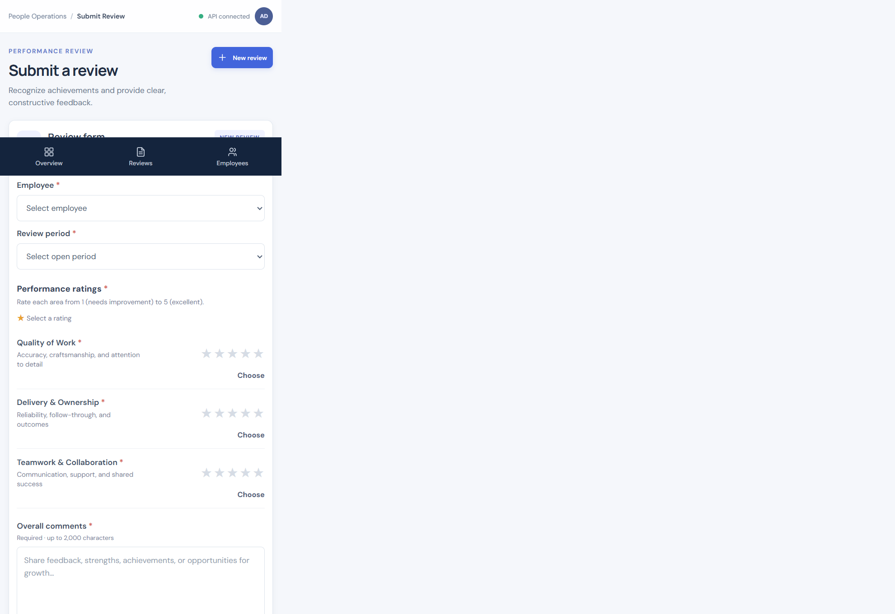
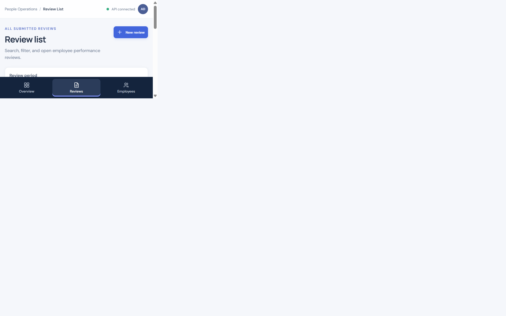

# Employee Performance Review
## Demo deck · PeoplePulse

> **Team walkthrough:** manager submission → validated API write → HR register

---

## 1 · The outcome

**One trusted review record, from manager input to HR visibility.**

`Manager submits` → `API validates and saves` → `HR reviews`

- Replace manual handoffs with a durable review register.
- Make rating rules and review-cycle rules explicit.
- Return the saved record and server-calculated average to the UI.

**Presenter:** “The goal is not just a form; it is a persisted, reviewable workflow.”

---

## 2 · Mandatory scope

### Two screens

1. **Submit review** — active employee, open period, three 1–5 ratings, required comments.
2. **Review register** — employee, period, ratings, server average, status.

### Four required APIs

| API | Purpose |
|---|---|
| `GET /api/employees` | Populate employee choices |
| `GET /api/review-periods` | Populate review-cycle choices |
| `GET /api/reviews` | Render and filter the HR register |
| `POST /api/reviews` | Validate and persist the manager submission |

---

## 3 · The live workflow

1. Employee and period selections are loaded from the API.
2. Manager sends numeric database IDs, ratings, and comments as JSON.
3. API checks validation, Open period, and employee/period uniqueness.
4. PostgreSQL stores the row; API returns HTTP **201** and `average_rating`.
5. The register refreshes from GET and shows the saved result.
6. Browser reload fetches the same persisted row again.

**Watch for:** review `25`, `EMP102`, `H2 2026`, ratings `4 / 5 / 4`, average **4.33**.

---

## 4 · Architecture and source of truth

```text
React + TypeScript
  App.tsx: shared data and routing
  components/: shell, pages, reusable UI
          │ typed JSON over Fetch
          ▼
FastAPI routes → service rules → PostgreSQL repository
```

- PostgreSQL is the persistence source.
- The API calculates the average; the UI displays the returned value.
- Creation uses numeric employee/period IDs; review filtering uses employee code and numeric period ID.
- Unique database constraint backs up the API's atomic duplicate check.

---

## 5 · Business rules and failure handling

| Scenario | Expected result |
|---|---|
| Rating outside 1–5 or invalid request | HTTP 422 with field-specific feedback |
| Same employee and period submitted again | HTTP 409 `DUPLICATE_REVIEW` |
| Closed period | HTTP 400 `REVIEW_PERIOD_CLOSED` |
| API/network unavailable | Clear unavailable message and retry |

Failed submissions keep the user's entered values. Only the server response supplies a saved average.

---

## 6 · Screens from the running app

### Submission form · draft screenshot



### HR review register · live GET data



---

## 7 · Verified evidence

- Live local PostgreSQL: **22 employees · 4 periods · 25 reviews**
- Required GET routes: **HTTP 200**
- Live UI POST: **HTTP 201**, review `id=25`, server average **4.33**
- The new row appeared immediately and remained after browser reload.
- Duplicate **409** · invalid rating **422** · Closed period **400**
- Backend: **35 tests passed** · Frontend build/type-check and lint passed

More detail: [readiness evidence](./readiness-evidence.md).

---

## 8 · Decisions and boundaries

### Confirm with the client

- Who can submit and view reviews?
- Who controls opening and closing periods?
- Is uniqueness per employee/period or per manager as well?
- What are feedback visibility and retention requirements?

### Not production-ready

No authentication or authorization. Use trusted demo data only. Schedule the team presentation and confirm discovery assumptions before production planning.

**Code:** [github.com/rahulpokharkar64/employee-review](https://github.com/rahulpokharkar64/employee-review)
